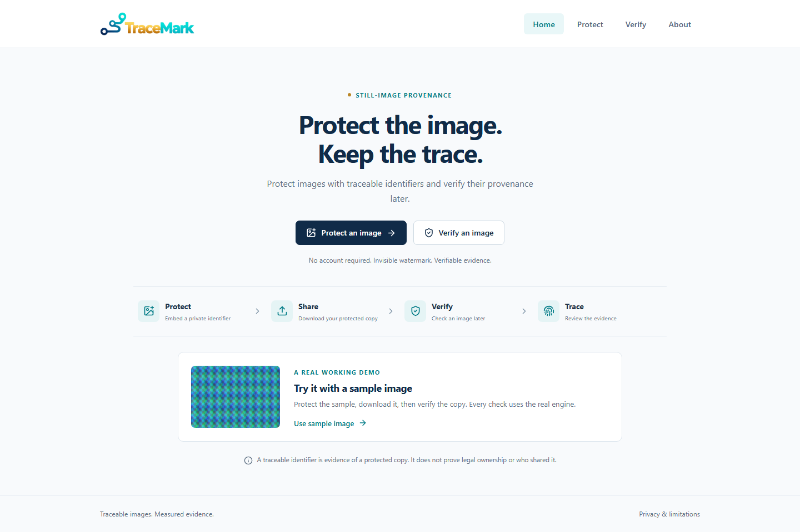
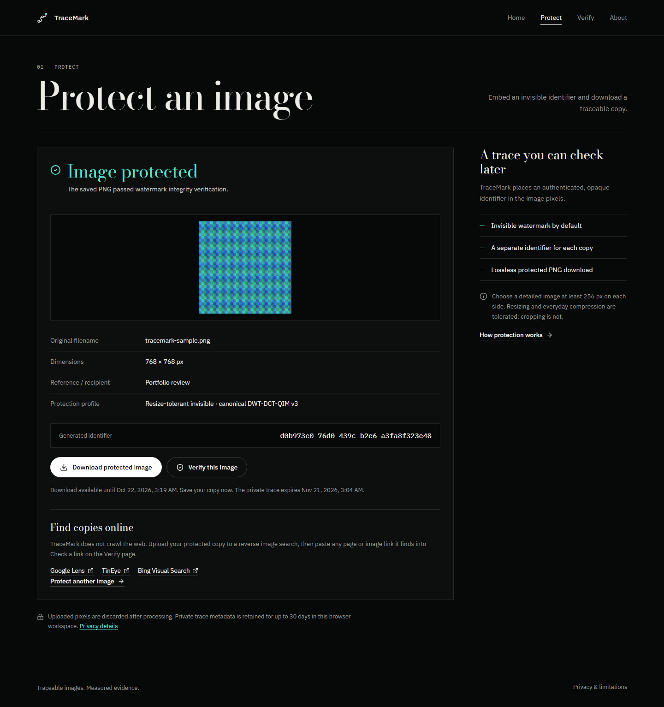
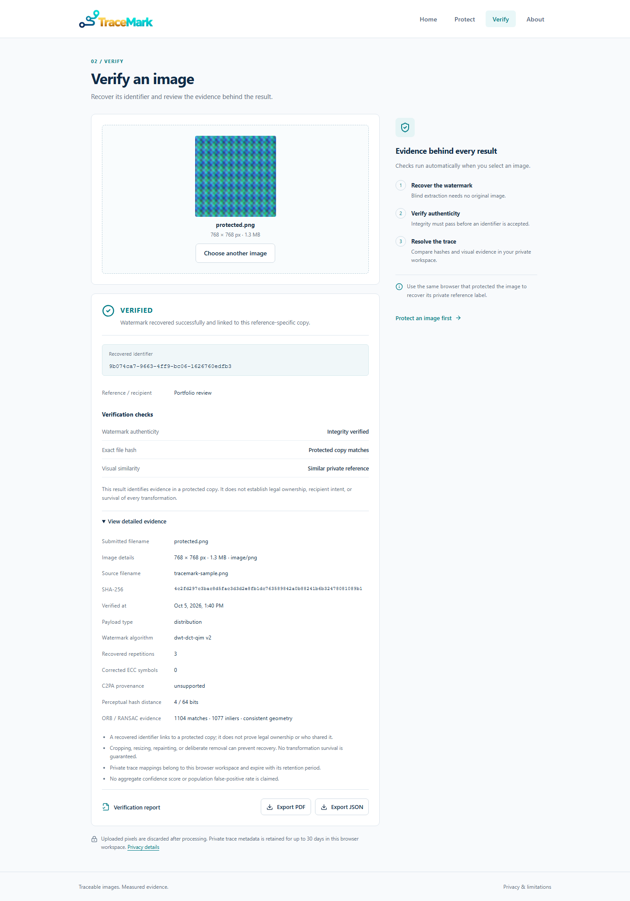
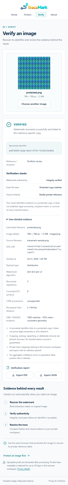
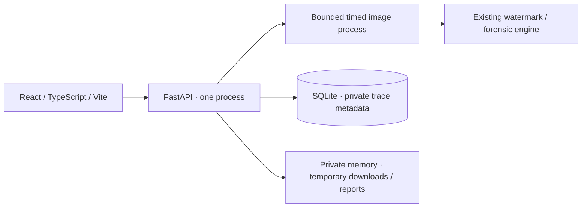

# TraceMark

<p align="center">
  
</p>

**Protect images with traceable identifiers and verify their provenance later.**

## Overview

Download the protected copy, upload it later, and inspect the evidence behind its provenance result. A hosted demo is not available yet; run it locally with the setup below.

TraceMark is a focused security portfolio project. Its checks use a real classical watermark engine. A recovered identifier does not prove legal ownership, authorship, recipient intent or who shared a file.



## Key features

- Invisible, authenticated identifiers in image pixels, with a separate identifier for each protected copy.
- A resolution-independent watermark (v3) that survives resizing, upscaling and everyday JPEG/WebP compression in the benchmark below.
- **Check a link**: paste an image URL, or a page URL whose images (up to eight) are fetched through an SSRF-safe fetcher and verified.
- Guidance and links for reverse image search (Google Lens, TinEye, Bing) to find copies; TraceMark itself never crawls the web.
- Signed backup and restore of private trace records, so labels survive cookie loss and can move to another browser.
- Optional private recipient/reference labels that never enter the image.
- Evidence that separates watermark integrity, exact hashes, visual similarity and optional provenance.
- Private browser workspaces, temporary downloads and PDF/JSON exports without accounts.

## Core workflow

1. **Protect** a JPEG, PNG or WebP image. Optionally add a private recipient/reference label.
2. **Download** the protected PNG.
3. **Verify** a copy later in the same browser workspace: upload it, or paste the link where you found it.
4. Review authenticity, exact hashes and visual evidence; export **PDF or JSON**.

Home includes a generated sample that runs through the same engine. No account or dashboard is required.




<details>
<summary>Mobile evidence and report exports</summary>



</details>

## Protection and verification

New protections use the v3 engine: the image's luminance is resampled to a fixed 256 × 256 canonical grid, the authenticated codeword is quantized into keyed 4 × 4 DCT coefficients of the canonical Haar LH/HL bands, and the canonical residual is resampled back over a few closed-loop passes. Extraction resamples any copy to the same grid, so resizing is undone before reading. Images smaller than 256 px per side, and copies protected earlier, use the original v2 engine, which remains supported for verification. Both embed a random 128-bit token. Reed-Solomon error correction supports recovery; a domain-separated HMAC must pass before any token is accepted. Private labels are resolved from the registry and never embedded in pixels. Every protected PNG is decoded and extracted before the API reports success.

Verification tries the bounded supported robust strengths and the existing LSB baseline. SHA-256, perceptual hashes, actual ORB/RANSAC feature checks and optional C2PA inspection remain separate measurements. **VERIFIED** requires a valid watermark and a trace authorized to the browser workspace. Similarity or an exact unmarked source hash alone cannot produce that result. An authentic watermark without an accessible private mapping is reported explicitly.

## Architecture



The static frontend runs on Netlify, Vercel or equivalent hosting. FastAPI runs directly on a Python host. SQLite is required for private trace mappings across restarts; temporary artifacts remain in API memory. Run one API worker and instance.

## Local setup

Python 3.12, Node 24 and pnpm 10.30.3 are the reference toolchain.

Windows:

```powershell
./scripts/setup.ps1
./scripts/api.ps1
# Separate terminal:
pnpm --dir apps/web dev
```

Linux/macOS:

```sh
python3.12 -m venv .venv
. .venv/bin/activate
make setup
python -m uvicorn tracemark_api.main:create_app --factory --env-file .env --host 127.0.0.1 --port 8000 --no-access-log
# Separate terminal:
pnpm --dir apps/web dev
```

Open the Vite URL. Setup generates local secrets without printing them. The supplied logo is packaged by `scripts/prepare_assets.py`; generated brand/sample assets are checked in for static hosting.

## Direct deployment

Frontend: use the repository root and checked-in Netlify or Vercel configuration. Build `pnpm --dir apps/web build`, publish `apps/web/dist`, and set build-time `VITE_API_URL=https://api.your-domain.example/api/v1`. It is a public URL; frontend bundles contain no secrets.

Backend: create a native Python 3.12 service on Render or an equivalent host:

```sh
python -m pip install -r requirements.txt
python -m pip install --no-deps ./packages/watermark_engine ./apps/api
python -m uvicorn tracemark_api.main:create_app --factory --host 0.0.0.0 --port "$PORT" --workers 1 --no-access-log --no-proxy-headers
```

Attach persistent private storage, such as Render's paid disk at `/var/data`. Set `TRACEMARK_DATA_ROOT=/var/data/tracemark`, `TRACEMARK_ENV=production`, `TRACEMARK_COOKIE_SECURE=true` and exact HTTPS `TRACEMARK_ALLOWED_ORIGINS`. Set three independent stable environment secrets: `TRACEMARK_MASTER_KEY`, `TRACEMARK_REPORT_KEY`, `TRACEMARK_SESSION_PEPPER`. Each must have at least 32 characters. Additional limits are listed in `.env.example`.

Use HTTPS frontend/API subdomains of one site with SameSite=Lax cookies. Unrelated sites may block cookies; a same-origin hosting rewrite is another option. [Deployment](docs/DEPLOYMENT.md) covers settings, headers, storage and ingress requirements, with official provider references.

## Security and privacy

Uploaded pixels are discarded after processing. Downloads and reports are private, in memory and expire after 15 minutes by default; server restarts invalidate those links. Save the protected copy.

Only identifiers, hashes, compact visual descriptors, private labels and timestamps persist, for up to 30 days by default. An opaque HttpOnly browser cookie scopes every lookup. Cookie loss, expiry, another browser or clearing traces makes those mappings unavailable. About offers an explicit clear action.

Inputs are limited to 20 MiB, 4 million pixels and 4096 px per side. Animation and corrupt/spoofed images are rejected. A bounded child process has a hard 30-second deadline. CSRF, exact CORS, rate limits, resource quotas, safe filenames and a least-privileged API account cover the public workflow. No uploaded image has a public storage URL. Optional C2PA temporary files are cleaned even on timeout.

Multipart parsing may spool a large upload temporarily, and optional provenance inspection uses a temporary file. These are closed or removed after processing; no permanent image store is created. Bound temporary storage and CPU/memory at the Python host.

See [Security](SECURITY.md) and [Threat model](THREAT_MODEL.md).

## Supported formats and limitations

JPEG, PNG and WebP still-image inputs; lossless PNG protected output. Images need at least 256 px on each side. EXIF orientation is applied when protecting and metadata is stripped.

Quick benchmark (four deterministic synthetic fixtures, `docs/benchmark-quick.json`):

| Transformation | v3 (default) | v2 (legacy) |
|---|---|---|
| Clean / JPEG 85 | 4/4 / 4/4 | 4/4 / 4/4 |
| Resize to 75% | 4/4 | 0/4 |
| Resize to 50% + JPEG 80 | 4/4 | 0/4 |
| Upscale to 150% | 4/4 | 0/4 |
| WebP 80 | 4/4 | 0/4 |
| Center crop 5% | **0/4** | 0/4 |
| Unmarked controls accepted | 0 | 0 |

Cropping still defeats extraction, as do rotation, distortion, repainting, very heavy recompression and deliberate removal; social platforms often crop. v3 trades some invisibility for robustness (about 39–40 dB PSNR); faint grain can be visible in large flat dark areas on close inspection. The benchmark is reproducible evidence on synthetic fixtures, not a universal robustness claim. Optional C2PA unavailability does not invalidate independent pixel evidence. See [Watermark method](docs/WATERMARK_ALGORITHM.md) and [Limitations](LIMITATIONS.md).

## Finding and checking copies

TraceMark does not search the internet for watermarks; nothing indexes invisible marks. To look for copies, upload your protected image to a reverse image search (Google Lens, TinEye, Bing Visual Search). For any page or image you find, use **Check a link** on Verify. The API fetches only that URL, and for a page at most eight images it references (`og:image`, `img src`, `data-src` and the largest `srcset` candidate), through a DNS-pinned fetcher that refuses private, loopback, link-local and reserved addresses on every redirect. Each image runs through the normal timed verification; the strongest result becomes the full evidence and its report records where it was found. Link checks are rate-limited separately and can be disabled with `TRACEMARK_LINK_CHECKS=false`.

## Backing up trace records

About offers **Save trace records** and **Restore from file**. The export is JSON authenticated with a domain-separated HMAC under the report key, so a modified file or one from another deployment is rejected. Restoring moves those records into the current browser's workspace. The file is a bearer secret: anyone holding it can resolve those marks on this deployment.

## Reports and exports

Each verification result provides a PDF summary and a JSON evidence snapshot. JSON includes a service-secret HMAC checked before export; it is not a publicly verifiable signature. Reports inherit workspace isolation and the temporary download window. Exported evidence does not prove ownership or identify who shared a file.

## Testing

```sh
make lint
make test
make benchmark
make restart
pnpm --dir apps/web build
pnpm --dir apps/web e2e
pnpm audit --audit-level moderate
python -m pip_audit -r requirements.txt
python -m bandit -r apps/api/tracemark_api packages/watermark_engine/src scripts -q
```

PowerShell equivalents: `scripts/lint.ps1`, `scripts/test.ps1`, `scripts/benchmark.ps1`, `scripts/restart.ps1`. Browser tests build and serve the production frontend with a direct URL to a real isolated API and verify downloads/re-uploads/reports at 1440, 1366, 768 and 390 px. CLI benchmarks retain the robust and LSB engines plus negative controls.

Current measured results and any unavailable gates are recorded in [STATUS.md](STATUS.md). The restart check validates a cold native process restart, retained private mappings and expired temporary links.

## Repository

- `apps/web`: four-page browser app and E2E tests.
- `apps/api`: focused API, private registry, timed processing and report exports.
- `packages/watermark_engine`: reused independent watermark/forensic primitives.
- `tests`: meaningful algorithm, API and security regression coverage.
- `assets`: supplied TraceMark logo.
- `scripts`, `docs`: reproducible setup, deployment, evaluation and guides.

## Credits

Hero photograph: “an old fashioned camera with a black background” by Hooman R. on [Unsplash](https://unsplash.com/photos/an-old-fashioned-camera-with-a-black-background-FdNi_4Jg3_E), used under the Unsplash License. Typefaces: Bodoni Moda and IBM Plex (SIL Open Font License), self-hosted via Fontsource.

## License

No project source-code license has been granted in this repository. All rights remain with the respective owners; add a license before inviting redistribution. Generated demonstration fixtures are designated CC0 by their generator. The supplied branding remains its owner's asset.

## Author

Mosaddiqur Rahman.

